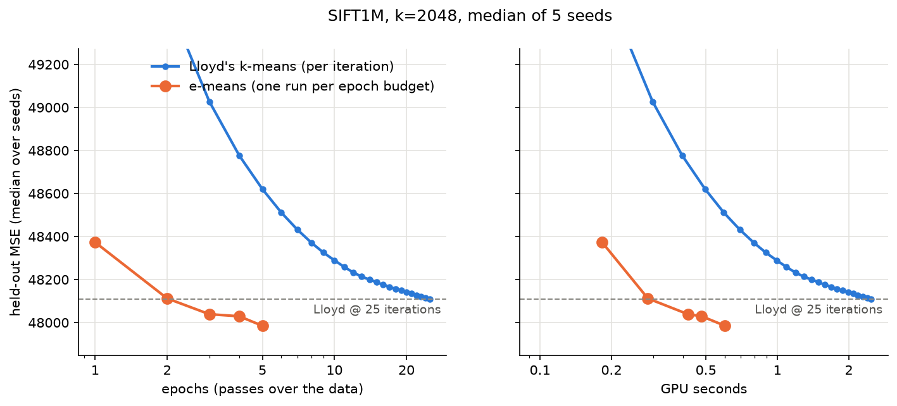

# e-means

A minimal PyTorch implementation of e-means ([Bessa et al., 2026](https://arxiv.org/abs/2611.09501)), a mini-batch replacement for k-means, benchmarked against Lloyd's k-means on SIFT1M. The reference implementation is [faiss/contrib/e_means](https://github.com/facebookresearch/faiss/tree/main/contrib/e_means).

On an RTX 3070 Laptop GPU (k=2048), e-means matches the held-out MSE of 25 Lloyd iterations in 2 epochs (about 0.3 s vs 2.5 s) and beats it from 3 epochs on.



## Run

Needs an NVIDIA GPU and [uv](https://docs.astral.sh/uv/).

```
uv run python main.py
```

The first run downloads SIFT1M (168 MB) into `data/`. It prints a table of time and MSE per epoch budget and saves `results.png`. Options: `uv run python main.py --help`.

## Use

```python
import torch
from clustering import e_means, mse

x = torch.randn(200_000, 64, device="cuda")
init = x[torch.randperm(len(x), device="cuda")[:512]]
centroids = e_means(x, init, epochs=3, seed=0)
print(mse(x, centroids))
```
